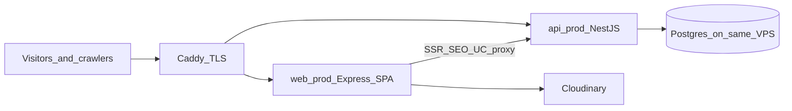

# Skálázhatóság: jelenlegi architektúra és teendők nagy forgalomnál

## Verdict

**Most: elég.** Egy Hetzner node, egy `api-prod`, egy `web-prod`, egy Postgres — tipikus korai SaaS / több településes katalógus forgalmára ez a helyes, egyszerű választás. Nem kell most Redis, multi-region vagy Kubernetes.

**Nagyon nagy forgalomnál: skálázható a modell, de nem „ahogy van”.** A kód nagy része stateless (JWT, Prisma → Postgres, Cloudinary), tehát *elvileg* több API példány mögé tehető. A gyakorlatban ma több in-memory állapot és egyetlen gép fogja meg a növekedést, mielőtt a domain-logika elfogyna.

Forrás: [deploy/docker-compose.yml](../deploy/docker-compose.yml), [deploy/Caddyfile](../deploy/Caddyfile), [apps/web/server.js](../apps/web/server.js).

---

## Mi van ma (röviden)

| Réteg | Állapot |
|---|---|
| Edge | Caddy, gzip, multi-domain + on-demand TLS (`/api/caddy/ask`) |
| Web | Egy Express process: static SPA + SEO/UC proxy az API-ra |
| API | Egy NestJS process; `@nestjs/throttler` **in-memory**; cron a `TasksModule`-ban |
| Cache | In-process Map-ek: ui-copy (~30s), sitemap, platform host lista — **nincs Redis** ([CHANGELOG](../CHANGELOG.md) is ezt jelzi) |
| DB | Postgres **ugyanazon a VPS-en**, nincs PgBouncer / read replica a compose-ban |
| Média | Cloudinary (jó: nem a saját lemez a bottleneck) |
| Deploy | GitHub Actions → SSH → egy host recreate ([.github/workflows/deploy.yml](../.github/workflows/deploy.yml)) |

**Single points of failure:** a Hetzner VM, a helyi Postgres volume, az egy API- és egy web-konténer. Deploy alatt rövid downtime / race (compose conflictokkal is előfordult).

---

## Mi törik el először nagy látogatószámnál

Sorrend spike alatt (assets és Cloudinary jellemzően *nem* az elsők):

1. **Uncached SSR HTML → API fan-out** — minden public navigáció a `web-prod` Expressen megy át ([apps/web/server.js](../apps/web/server.js)): UC gate + `/api/domain/:host` + share/content (2–N API hívás). A sikeres HTML-nek nincs `Cache-Control`; Caddy előtt nincs CDN. Explore CSR utána még places/events/towns (places limit 200, 10 perces poll).
2. **Nest API + Postgres** ugyanazon a VPS-en — middleware adó minden requesten: `SiteResolveMiddleware` (custom hostnál több Prisma lookup), UC lock (5s mem cache). Forró GET-ek: ui-copy, platform-settings, domain resolve, places/events listák. Write: analytics `upsert` request pathon, quote lead **await SMTP**.
3. **Egy web Node process** — document generation + upstream fetch; hashed JS/CSS `immutable`, a HTML/SSR a choke.
4. **In-memory throttle / cache / cron** — több API réplikánál szétesik (Throttler, ui-copy 30s, sitemap Map, UC cache, `UiTranslateService.jobs`); `@Cron` feladatok minden példányon újra futnának (`TasksModule`, notifications).
5. **Query költség** — places list túl vastag include (galleries + minden translation); events list slug **N+1** ([places.service.ts](../apps/api/src/places/places.service.ts), [events.service.ts](../apps/api/src/events/events.service.ts)).

JWT/auth multi-instance-kompatibilis (DB refresh); sticky session nem kell.

---

## Mikor kell cselekedni (trigger-ek, nem tippelés)

Ne „majd egyszer” skálázz; mérj, és ezeknél lépj:

- API/DB **p95 latency** tartósan rossz csúcsidőben
- Postgres CPU/disk vagy connection pool közel tele
- Node process **event-loop lag** / OOM a VPS-en
- Deploy vagy egy konténer-restart **észlelhető kiesés**, amit már nem fogadtok el
- Marketing / települési kampány előtt várható **spike** (akkor előre vertikális + CDN)

Amíg ezek nincsenek, a jelenlegi architektúra a helyes költség/komplexitás trade-off.

---

## Ajánlott fázisok (konkrét sorrend)

### Fázis 0 — Most (semmi infra-átépítés)

- Megtartani a single-node compose stacket.
- Observability: host CPU/RAM/disk, Postgres méret, API 5xx/p95; spike-nál nézni a web SSR upstream hívásokat és a domain/UC/platform/places útvonalakat.
- Lead form throttle+captcha marad spam ellen, nem skála ellen.

### Fázis 1 — Első nyomás: vertikális + olcsó nyereségek

- Nagyobb Hetzner csomag; Postgres egyelőre maradhat ugyanott.
- **Cloudflare (vagy hasonló) a Caddy előtt** + rövid TTL **HTML / public GET** cache ahol biztonságos (UC fail-closed kivételekkel).
- Vékonyabb list response: places ne vigyen full gallery+összes langot listában; events slug batch (N+1 megszüntetése).
- Domain resolve + platform-settings rövid shared/in-process cache erősítése; analytics batch vagy async buffer a sync `upsert` helyett, ha a track QPS nő.
- Quote email ne blokkolja a HTTP választ (fire-and-forget / queue előkészítés).

### Fázis 2 — Horizontális API előtt kötelező előkészítés

Redis:

- Throttler storage
- Ui-copy / sitemap / platform-host / UC shared cache + invalidation
- Cron leader vagy külön worker (`TasksModule` + notification cron ne fusson minden API réplikán)

Postgres **le az app-noderól** + pooler, mielőtt több API példány nyitna kapcsolatot (`PrismaPg` default pool könnyen kimerül).

### Fázis 3 — Valódi skála

- `api-prod` N réplika; web réplika vagy CDN+static origin.
- Read replica a listázó public GET-ekre.
- Queue: email, analytics, ui-translate, bulk import (BullMQ + Redis).
- Multi-region csak EU/DR üzleti követelményre.

### Fázis 4 — Extrém (csak ha a termék tényleg ott van)

- Separált search (OpenSearch/Meilisearch) a nehéz place kereséshez
- Edge caching / ISR jellegű HTML a legnézettebb town/place oldalakra
- Sharding / tenant-partitioning site/town mentén — csak ha egy DB már objektíven kevés

---

## Ami *nem* kell most

- Kubernetes / microservices szétvágás
- Neon + Hetzner Postgres párhuzamosan „biztonságból”
- Minden endpoint Redis-elése
- Globális multi-region

A monolit Nest + Prisma + egy Postgres **jól elvisz** a következő növekedési szinteken, ha a fázis 1–2 előkészítés megvan, mielőtt réplikálnátok.

---

## Összegzés egy mondatban

**Skálázható az irány (stateless API + Postgres + CDN-képes front), de a mai deploy egy gépre van optimalizálva; nagyon nagy forgalomnál először mérés + nagyobb gép + CDN/cache, utána Redis és külön DB, majd API réplikák — ebben a sorrendben.**
